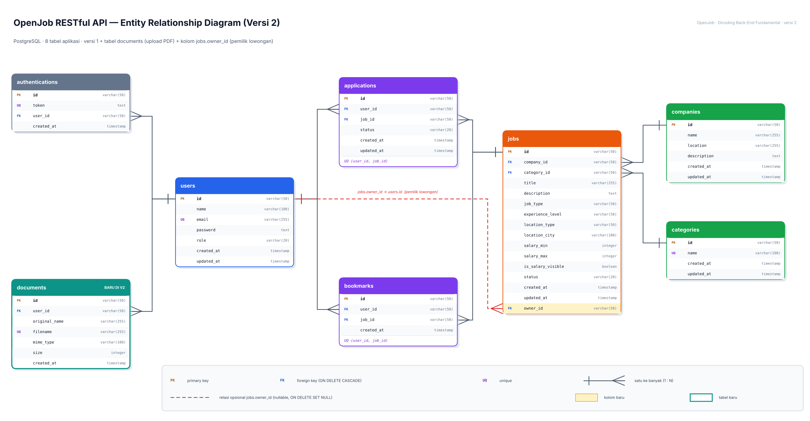
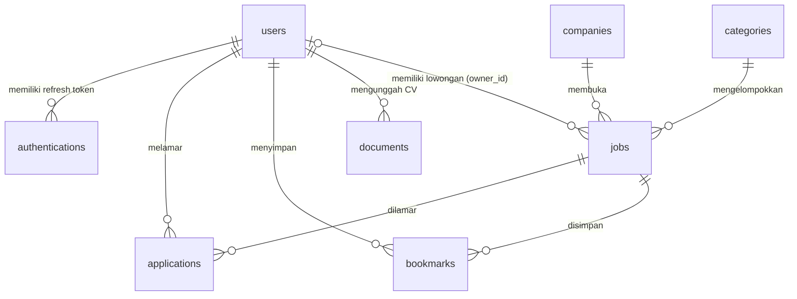

# OpenJob RESTful API (Versi 2)

RESTful API untuk aplikasi internal rekrutmen **OpenJob**. API ini mengelola pengguna, perusahaan, kategori, lowongan, lamaran, bookmark, dan berkas CV, dilengkapi autentikasi JWT, caching Redis, serta notifikasi email asynchronous lewat RabbitMQ.

Proyek ini dibuat sebagai submission studi kasus *Back-End Developer* (Dicoding). Dokumen ini mencakup **Versi 1** (fondasi API) dan **Versi 2** (upload berkas, caching, message queue). README khusus Versi 1 tersedia di `README-OpenJob-versi-1.md`.

---

## Daftar Isi

1. [Fitur](#fitur)
2. [Teknologi](#teknologi)
3. [Prasyarat](#prasyarat)
4. [Instalasi dan Setup](#instalasi-dan-setup)
5. [Variabel Environment](#variabel-environment)
6. [Menjalankan Aplikasi](#menjalankan-aplikasi)
7. [Menguji dengan Postman](#menguji-dengan-postman)
8. [Struktur Proyek](#struktur-proyek)
9. [Desain Database dan ERD](#desain-database-dan-erd)
10. [Daftar Endpoint](#daftar-endpoint)
11. [Upload Berkas PDF](#upload-berkas-pdf)
12. [Caching dengan Redis](#caching-dengan-redis)
13. [Message Queue dengan RabbitMQ](#message-queue-dengan-rabbitmq)
14. [Format Response](#format-response)
15. [Autentikasi dan Otorisasi](#autentikasi-dan-otorisasi)
16. [Troubleshooting](#troubleshooting)
17. [Catatan Pengembangan](#catatan-pengembangan)

---

## Fitur

**Versi 1**
- Registrasi, login, refresh token, dan logout dengan **JWT** (refresh token disimpan di database).
- CRUD **Companies**, **Categories**, dan **Jobs**, termasuk pencarian lowongan (`?title` dan `?company-name`).
- **Applications** (lamaran), **Bookmarks**, dan **Profile** pengguna yang sedang login.
- Validasi data dengan **Joi** lewat middleware, dan middleware khusus untuk **error handling**.
- Database dikelola dengan **migration** (`node-pg-migrate`).

**Versi 2**
- **Upload CV (PDF)** dengan `multer`: maksimal 5 MB, hanya `application/pdf`, metadata disimpan di database, dan berkas dapat diunduh.
- **Caching Redis** dengan TTL 1 jam, header `X-Data-Source`, dan invalidasi cache otomatis.
- **RabbitMQ**: setiap lamaran baru dipublikasikan ke antrean, lalu **consumer** (program terpisah) mengirim email notifikasi ke **pemilik lowongan** lewat **Nodemailer**.

## Teknologi

| Komponen | Teknologi |
| :--- | :--- |
| Runtime | Node.js v22 (LTS) |
| Framework | Express.js v5 |
| Database | PostgreSQL |
| Migration | `node-pg-migrate` |
| Validasi | Joi |
| Autentikasi | `jsonwebtoken` (JWT) |
| Hashing password | `bcrypt` |
| ID unik | `nanoid` v3 |
| Upload berkas | `multer` |
| Cache | Redis (`redis` / node-redis) |
| Message broker | RabbitMQ (`amqplib`) |
| Email | `nodemailer` |
| Dev tools | `nodemon` |

Proyek memakai **ES Modules** (`"type": "module"` di `package.json`).

## Prasyarat

Pastikan sudah terpasang:

- **Node.js v22** (cek dengan `node -v`) dan **npm**
- **PostgreSQL** (disarankan versi 15 ke atas) beserta `psql`
- **Redis** (Docker, atau Redis/Memurai/WSL, lihat langkah 3)
- **RabbitMQ** (Docker, atau instalasi native, lihat langkah 3)
- Akun **Ethereal** (gratis, untuk menampung email uji, lihat langkah 4)
- **Postman**

## Instalasi dan Setup

### 1. Ambil proyek dan pasang dependency

```bash
git clone <url-repository>
cd <nama-folder-proyek>
npm install
```

### 2. Siapkan database PostgreSQL

Masuk sebagai superuser, misalnya `psql -U postgres -h localhost`, lalu jalankan (ganti password sesuai keinginan):

```sql
CREATE USER openjob WITH PASSWORD 'ganti_password_ini';
CREATE DATABASE open_job OWNER openjob;
```

Dengan menjadikan `openjob` sebagai **pemilik** database, user tersebut boleh membuat tabel di schema `public` (penting untuk PostgreSQL 15 ke atas). Kalau database sudah ada dengan pemilik lain, jalankan `GRANT USAGE, CREATE ON SCHEMA public TO openjob;` saat terhubung ke database tersebut.

Tabel **tidak dibuat manual**, semuanya dibuat oleh migration (langkah 6).

### 3. Jalankan Redis dan RabbitMQ

**Cara termudah: Docker**

```bash
docker run -d --name openjob-redis -p 6379:6379 redis:7-alpine
docker run -d --name openjob-rabbitmq -p 5672:5672 -p 15672:15672 rabbitmq:management
```

Verifikasi:

- Redis: `docker exec -it openjob-redis redis-cli ping` harus membalas `PONG`.
- RabbitMQ: buka UI manajemen di `http://localhost:15672` (login bawaan `guest` / `guest`, hanya berlaku dari localhost).

Setelah komputer restart, nyalakan lagi dengan `docker start openjob-redis openjob-rabbitmq`.

**Tanpa Docker** (contoh untuk Windows)

- Redis: pasang **Memurai** (kompatibel dengan Redis, berjalan sebagai Windows service di port 6379), atau Redis lewat WSL2 (`sudo apt install redis-server`). Verifikasi dengan `memurai-cli ping` atau `redis-cli ping`.
- RabbitMQ: pasang **Erlang/OTP** (64-bit) terlebih dahulu, lalu **RabbitMQ Server** dari rabbitmq.com (pastikan versi Erlang kompatibel). Untuk UI manajemen jalankan `rabbitmq-plugins enable rabbitmq_management`.

### 4. Siapkan SMTP uji dengan Ethereal

Notifikasi email diuji memakai **Ethereal**, layanan SMTP palsu: semua email **ditangkap dan tidak pernah dikirim ke alamat tujuan sebenarnya**, jadi aman dipakai walau data uji memuat alamat email nyata.

1. Buka `https://ethereal.email`, lalu klik **Create Ethereal Account**.
2. Salin kredensial yang ditampilkan: host (`smtp.ethereal.email`), port (`587`), username, dan password.
3. Isi nilainya ke `MAIL_HOST`, `MAIL_PORT`, `MAIL_USER`, dan `MAIL_PASSWORD` di `.env` (langkah 5).
4. Untuk melihat email yang masuk, login di `https://ethereal.email/login` dengan username dan password tadi, lalu buka menu **Messages** (`https://ethereal.email/messages`).

> Akun Ethereal bersifat sementara. Kalau kredensial sudah tidak berlaku, buat akun baru dan perbarui `.env`.

### 5. Buat file `.env`

```bash
cp .env.example .env
```

(Di Windows PowerShell: `Copy-Item .env.example .env`.)

Buat dua secret key JWT yang **berbeda** dengan perintah berikut, jalankan dua kali:

```bash
node -e "console.log(require('crypto').randomBytes(64).toString('hex'))"
```

Rincian tiap variabel ada di bagian [Variabel Environment](#variabel-environment).

> **Penting:** gunakan `PORT=3000` agar sesuai dengan environment Postman (`port = 3000`).

### 6. Jalankan migration

```bash
npm run migrate up -- --envPath .env
```

Perintah ini membuat 8 tabel aplikasi (`users`, `companies`, `categories`, `authentications`, `jobs`, `applications`, `bookmarks`, `documents`) ditambah tabel pencatat `pgmigrations`. Output berhasil diakhiri `Migrations complete!`.

Tanda `--` memberi tahu npm bahwa opsi sesudahnya ditujukan ke `node-pg-migrate`. Opsi `--envPath .env` diperlukan karena `node-pg-migrate` tidak membaca `.env` secara otomatis.

| Tujuan | Perintah |
| :--- | :--- |
| Membatalkan migration terakhir | `npm run migrate down -- --envPath .env` |
| Membuat file migration baru | `npm run migrate create nama-migration` |

### 7. Jalankan server dan consumer

Server dan consumer adalah **dua proses terpisah**, jalankan di dua terminal:

```bash
# Terminal 1: server HTTP
npm run start:dev

# Terminal 2: consumer RabbitMQ (pengirim email notifikasi)
npm run start:consumer
```

Tanda berhasil:

- Server: `Server berjalan pada http://localhost:3000`, `Redis terhubung`, dan log koneksi RabbitMQ.
- Consumer: `Consumer terhubung. Menunggu pesan...`

## Variabel Environment

File `.env.example`:

```dotenv
# HTTP server
HOST=localhost
PORT=3000

# PostgreSQL
PGUSER=openjob
PGPASSWORD=ganti_password_ini
PGDATABASE=open_job
PGHOST=localhost
PGPORT=5432

# JWT secret (dua nilai harus berbeda)
ACCESS_TOKEN_KEY=isi_dengan_string_acak_panjang
REFRESH_TOKEN_KEY=isi_dengan_string_acak_lain

# Redis
REDIS_HOST=localhost
REDIS_PORT=6379

# RabbitMQ
RABBITMQ_HOST=localhost
RABBITMQ_PORT=5672
RABBITMQ_USER=guest
RABBITMQ_PASSWORD=guest

# SMTP (contoh: Ethereal)
MAIL_HOST=smtp.ethereal.email
MAIL_PORT=587
MAIL_USER=isi_username_ethereal
MAIL_PASSWORD=isi_password_ethereal
```

| Variabel | Fungsi |
| :--- | :--- |
| `HOST`, `PORT` | Alamat dan port HTTP server |
| `PGUSER`, `PGPASSWORD`, `PGDATABASE`, `PGHOST`, `PGPORT` | Koneksi PostgreSQL (dibaca otomatis oleh library `pg`) |
| `ACCESS_TOKEN_KEY` | Secret access token (masa berlaku 3 jam) |
| `REFRESH_TOKEN_KEY` | Secret refresh token |
| `REDIS_HOST` | Alamat Redis (wajib). Kalau `localhost` gagal di Windows karena IPv6, pakai `127.0.0.1` |
| `REDIS_PORT` | Port Redis (opsional, bawaan `6379`) |
| `RABBITMQ_HOST`, `RABBITMQ_PORT`, `RABBITMQ_USER`, `RABBITMQ_PASSWORD` | Koneksi RabbitMQ |
| `MAIL_HOST`, `MAIL_PORT`, `MAIL_USER`, `MAIL_PASSWORD` | Kredensial SMTP untuk Nodemailer. Port 465 memakai koneksi aman langsung, port lain (misalnya 587) memakai STARTTLS |

Tidak ada kredensial yang ditulis langsung di kode.

## Menjalankan Aplikasi

| Perintah | Fungsi |
| :--- | :--- |
| `npm run start:dev` | Server HTTP dengan `nodemon` (restart otomatis saat file `.js` berubah) |
| `npm run start:consumer` | Consumer RabbitMQ yang mengirim email notifikasi |
| `npm run migrate ...` | Menjalankan `node-pg-migrate` |

> `nodemon` hanya memantau file `js`, `mjs`, `cjs`, dan `json`. Setelah mengubah `.env`, restart server dan consumer secara manual.

## Menguji dengan Postman

1. Import koleksi **OpenJob API Test V2** dan environment **OpenJob API**, lalu **pilih environment tersebut**.
2. Pastikan server berjalan di port yang sama dengan variabel `port` di environment (`3000`).
3. Di request **Upload Document with Valid PDF**, buka tab *Body* dan **pilih berkas PDF dari komputermu** (path bawaan koleksi menunjuk ke komputer pembuat soal).
4. Kosongkan data sebelum setiap run penuh, karena koleksi memakai email dan nama kategori yang tetap:

   ```sql
   TRUNCATE users, companies, categories CASCADE;
   ```

   `CASCADE` ikut mengosongkan `jobs`, `applications`, `bookmarks`, `authentications`, dan `documents`. Kosongkan juga cache: `redis-cli flushall` (atau `memurai-cli flushall`).
5. Jalankan **seluruh koleksi dalam satu run** lewat **Collection Runner**, dengan urutan folder bawaan. Folder saling bergantung pada data dan token dari folder sebelumnya, jadi menjalankan satu folder sendirian bisa memberi hasil merah yang menyesatkan.
6. Untuk melihat hasil notifikasi, pastikan **consumer berjalan**, lalu buka inbox Ethereal. Test Postman sendiri hanya memeriksa respons API dan tidak bergantung pada consumer.

## Struktur Proyek

```
.
├── migrations/                  # File migration (timestamp otomatis)
├── src/
│   ├── config/
│   │   ├── database.js          # Pool PostgreSQL
│   │   └── redis.js             # Klien Redis
│   ├── controllers/             # Menerima request dan mengirim response
│   ├── exceptions/              # Class error kustom (400, 401, 403, 404)
│   ├── middlewares/
│   │   ├── auth.js              # Autentikasi access token
│   │   ├── validate.js          # Validasi body dengan Joi
│   │   ├── upload.js            # Konfigurasi multer (PDF, 5 MB)
│   │   └── errorHandler.js      # Penanganan error global
│   ├── routes/                  # Definisi URL dan method
│   ├── services/
│   │   ├── *Service.js          # Logika bisnis dan query database
│   │   ├── cacheService.js      # get, set, del cache Redis
│   │   └── messageService.js    # Publisher RabbitMQ
│   ├── utils/
│   │   └── tokenManager.js      # Pembuatan dan verifikasi JWT
│   ├── validators/              # Skema Joi
│   ├── consumer.js              # Consumer RabbitMQ + Nodemailer (proses terpisah)
│   └── server.js                # Titik masuk server HTTP
├── uploads/                     # PDF yang diunggah (dibuat otomatis, tidak di-commit)
├── .env.example
├── .gitignore
├── ERD-OpenJob-versi-1.png
├── ERD-OpenJob-versi-2.png
├── README.md
├── README-OpenJob-versi-1.md
└── package.json
```

Setiap lapisan punya satu tanggung jawab (*separation of concerns*): route menentukan URL, middleware memvalidasi dan mengautentikasi, controller mengatur response, dan service menjalankan query. Service tidak mengenal objek `req` dan `res`, sehingga bisa dipakai ulang oleh consumer.

## Desain Database dan ERD

Tersedia dua diagram:

| Berkas | Isi |
| :--- | :--- |
| `ERD-OpenJob-versi-1.png` | 7 tabel hasil migration Versi 1 |
| `ERD-OpenJob-versi-2.png` | Versi 1 ditambah tabel `documents` dan kolom `jobs.owner_id` |





| Tabel | Kolom utama | Keterangan |
| :--- | :--- | :--- |
| `users` | `id`, `name`, `email` (**unique**), `password` (hash), `role` | Akun pengguna |
| `companies` | `id`, `name`, `location`, `description` | Profil perusahaan |
| `categories` | `id`, `name` (**unique**) | Kategori pekerjaan |
| `authentications` | `id`, `token` (**unique**), `user_id` | Refresh token yang aktif |
| `jobs` | `id`, `company_id`, `category_id`, `owner_id`, `title`, `description`, `job_type`, `experience_level`, `location_type`, `location_city`, `salary_min`, `salary_max`, `is_salary_visible`, `status` | Lowongan. `owner_id` (nullable) diisi dari pembuat lowongan |
| `applications` | `id`, `user_id`, `job_id`, `status` | Lamaran. **Unique gabungan** `user_id` + `job_id` |
| `bookmarks` | `id`, `user_id`, `job_id` | Bookmark. **Unique gabungan** `user_id` + `job_id` |
| `documents` | `id`, `user_id`, `original_name`, `filename` (**unique**), `mime_type`, `size` | Metadata berkas CV |

Catatan desain:

- Semua `id` berupa string acak berawalan nama resource (misalnya `user-xxxxxxxx`) agar tidak mudah ditebak.
- Satu job punya satu kategori dan satu perusahaan. `applications` dan `bookmarks` adalah tabel penghubung many-to-many antara `users` dan `jobs`.
- Semua foreign key memakai `ON DELETE CASCADE`, kecuali `jobs.owner_id` yang memakai `ON DELETE SET NULL` (lowongan tidak ikut terhapus bila akun pemiliknya dihapus).
- Satu user bisa punya banyak refresh token (login dari beberapa perangkat).

## Daftar Endpoint

### Public (tanpa autentikasi)

| Resource | Method | Endpoint | Keterangan |
| :--- | :---: | :--- | :--- |
| Users | `POST` | `/users` | Registrasi pengguna baru |
| | `GET` | `/users/:id` | Profil pengguna (di-cache) |
| Authentications | `POST` | `/authentications` | Login |
| | `PUT` | `/authentications` | Memperbarui access token |
| Companies | `GET` | `/companies` | Daftar perusahaan |
| | `GET` | `/companies/:id` | Detail perusahaan (di-cache) |
| Categories | `GET` | `/categories` | Daftar kategori |
| | `GET` | `/categories/:id` | Detail kategori |
| Jobs | `GET` | `/jobs` | Daftar lowongan (mendukung `?title` dan `?company-name`) |
| | `GET` | `/jobs/:id` | Detail lowongan |
| | `GET` | `/jobs/company/:companyId` | Lowongan berdasarkan perusahaan |
| | `GET` | `/jobs/category/:categoryId` | Lowongan berdasarkan kategori |
| Documents | `GET` | `/documents` | Daftar metadata dokumen |
| | `GET` | `/documents/:id` | Menampilkan atau mengunduh berkas PDF |

### Protected (header `Authorization: Bearer <access_token>`)

| Resource | Method | Endpoint | Keterangan |
| :--- | :---: | :--- | :--- |
| Authentications | `DELETE` | `/authentications` | Logout (menghapus refresh token) |
| Profile | `GET` | `/profile` | Profil pengguna yang login |
| | `GET` | `/profile/applications` | Lamaran milik saya |
| | `GET` | `/profile/bookmarks` | Bookmark milik saya |
| Companies | `POST` | `/companies` | Membuat perusahaan |
| | `PUT` | `/companies/:id` | Memperbarui perusahaan |
| | `DELETE` | `/companies/:id` | Menghapus perusahaan |
| Categories | `POST` | `/categories` | Membuat kategori |
| | `PUT` | `/categories/:id` | Memperbarui kategori |
| | `DELETE` | `/categories/:id` | Menghapus kategori |
| Jobs | `POST` | `/jobs` | Membuat lowongan (pembuat menjadi pemilik) |
| | `PUT` | `/jobs/:id` | Memperbarui lowongan |
| | `DELETE` | `/jobs/:id` | Menghapus lowongan |
| Applications | `POST` | `/applications` | Melamar pekerjaan (memicu notifikasi) |
| | `GET` | `/applications` | Semua lamaran |
| | `GET` | `/applications/:id` | Detail lamaran (di-cache) |
| | `GET` | `/applications/user/:userId` | Lamaran berdasarkan user (di-cache) |
| | `GET` | `/applications/job/:jobId` | Lamaran berdasarkan lowongan (di-cache) |
| | `PUT` | `/applications/:id` | Memperbarui status lamaran |
| | `DELETE` | `/applications/:id` | Menghapus lamaran |
| Bookmarks | `POST` | `/jobs/:jobId/bookmark` | Menyimpan lowongan |
| | `GET` | `/jobs/:jobId/bookmark/:id` | Detail bookmark |
| | `DELETE` | `/jobs/:jobId/bookmark` | Menghapus bookmark (berdasarkan user dan job) |
| | `GET` | `/bookmarks` | Semua bookmark milik saya (di-cache) |
| Documents | `POST` | `/documents` | Mengunggah PDF (multipart/form-data) |
| | `DELETE` | `/documents/:id` | Menghapus dokumen (hanya pemilik) |

### Contoh request

**Registrasi**

```http
POST /users
Content-Type: application/json

{
  "name": "John Doe",
  "email": "john@example.com",
  "password": "password123",
  "role": "user"
}
```

**Login**

```http
POST /authentications
Content-Type: application/json

{
  "email": "john@example.com",
  "password": "password123"
}
```

Respons berisi `accessToken` dan `refreshToken`. Gunakan `accessToken` pada header `Authorization: Bearer <access_token>` untuk endpoint protected.

**Pencarian lowongan**

```http
GET /jobs?title=backend&company-name=tech
```

Parameter kosong atau tidak diisi diperlakukan sebagai tanpa filter. Pencarian tidak membedakan huruf besar dan kecil, dan hasil yang tidak cocok mengembalikan `jobs: []`.

**Upload CV**

```http
POST /documents
Authorization: Bearer <access_token>
Content-Type: multipart/form-data

document=<berkas.pdf>
```

### Aturan validasi singkat

| Resource | Aturan |
| :--- | :--- |
| Users | `name` wajib, `email` format email dan wajib, `password` minimal 6 karakter, `role` opsional (bawaan `user`) |
| Companies | `name` dan `location` wajib, `description` opsional |
| Categories | `name` wajib dan tidak boleh kosong |
| Jobs | `company_id`, `category_id`, `title`, `description`, `job_type`, `experience_level`, `location_type` wajib. `salary_*` berupa angka, `is_salary_visible` boolean, `status` bawaan `open` |
| Applications | `job_id` wajib, `status` bawaan `pending`. `user_id` di body diabaikan, identitas diambil dari token |
| Authentications | Login: `email` dan `password` wajib. Refresh dan logout: `refreshToken` wajib |

### Catatan bentuk response daftar

Beberapa endpoint daftar menyertakan data gabungan (join) agar klien tidak perlu request tambahan:

| Endpoint | Isi tiap item |
| :--- | :--- |
| `GET /jobs` | 13 properti, termasuk `company_name` (tanpa `description`, `owner_id`, dan timestamp) |
| `GET /applications` | Data lamaran ditambah nama dan email pelamar, judul lowongan, perusahaan, `job_type`, `location_type` |
| `GET /profile/applications` | Data lamaran ditambah ringkasan lowongan dan perusahaan |
| `GET /bookmarks`, `GET /profile/bookmarks` | Data bookmark ditambah ringkasan lowongan, perusahaan, dan kategori |

Endpoint detail (`/jobs/:id` dan sejenisnya) mengembalikan data lengkap.

## Upload Berkas PDF

- Field form-data: **`document`**, satu berkas per request.
- **Validasi:** maksimal **5 MB** (melebihi batas dibalas `413`), dan hanya MIME type **`application/pdf`** (selain itu `400`). Request tanpa berkas dibalas `400` dengan pesan `File is required`.
- **Penyimpanan:** berkas disimpan di folder `uploads/` dengan **nama acak** (`nanoid`), bukan nama asli dari klien, untuk mencegah path traversal dan tabrakan nama. Nama asli disimpan di database (`original_name`).
- **Database:** metadata (`id`, `user_id`, `original_name`, `filename`, `mime_type`, `size`) disimpan di tabel `documents`. Kalau `INSERT` gagal, berkas yang sudah tersimpan di disk dihapus kembali.
- **Respons sukses (201):** `data: { documentId, filename, originalName, size }`.
- **Unduh:** `GET /documents/:id` mengirim berkas PDF lengkap dengan header `Content-Disposition`.
- **Hapus:** `DELETE /documents/:id` hanya boleh dilakukan pemilik dokumen (`403` untuk pengguna lain) dan ikut menghapus berkas di disk.

## Caching dengan Redis

Pola **cache-aside**: cek Redis dulu, kalau tidak ada ambil dari PostgreSQL lalu simpan ke Redis. **TTL semua cache: 3600 detik (1 jam).**

Setiap respons endpoint yang di-cache membawa header **`X-Data-Source`**:

| Nilai | Arti |
| :--- | :--- |
| `database` | Data diambil dari PostgreSQL (cache miss) |
| `cache` | Data diambil dari Redis (cache hit) |

| Endpoint | Key |
| :--- | :--- |
| `GET /companies/:id` | `companies:{id}` |
| `GET /users/:id` | `users:{id}` |
| `GET /applications/:id` | `applications:{id}` |
| `GET /applications/user/:userId` | `applications:user:{userId}` |
| `GET /applications/job/:jobId` | `applications:job:{jobId}` |
| `GET /bookmarks` | `bookmarks:user:{userId}` (per pengguna) |

**Invalidasi otomatis** (cache dihapus setelah operasi tulis berhasil):

| Aksi | Key yang dihapus |
| :--- | :--- |
| Create, update, delete company | `companies:{id}` |
| Create application | `applications:user:{userId}`, `applications:job:{jobId}` |
| Update dan delete application | `applications:{id}`, `applications:user:{userId}`, `applications:job:{jobId}` |
| Create dan delete bookmark | `bookmarks:user:{userId}` |

Catatan:

- Respons error (misalnya 404) **tidak** disimpan di cache.
- Endpoint protected tetap melewati autentikasi **sebelum** pengecekan cache.
- Kalau Redis tidak tersedia, API tetap berjalan normal dengan membaca langsung dari database.

Memeriksa isi cache: `redis-cli keys *`, `redis-cli ttl <key>`, dan `redis-cli flushall` untuk mengosongkan.

## Message Queue dengan RabbitMQ

Alur saat kandidat melamar:

```
POST /applications ──► simpan lamaran di PostgreSQL ──► publish { "application_id": "..." }
                                                              │
                                                  antrean: application_notifications
                                                              │
                                                  consumer (proses terpisah)
                                                              │
                          query database ──► Nodemailer ──► email ke PEMILIK LOWONGAN
```

- **Publisher** (`src/services/messageService.js`): mengirim pesan **hanya setelah** lamaran berhasil disimpan. Payload hanya berisi `application_id`. Antrean `durable` dan pesan `persistent`, sehingga bertahan saat RabbitMQ restart. Koneksi dibuat sekali dan dipakai ulang. Kalau RabbitMQ tidak tersedia, lamaran tetap tersimpan dan API tetap membalas `201` (kegagalan hanya dicatat di log).
- **Consumer** (`src/consumer.js`): program terpisah yang memproses satu pesan sampai tuntas (`prefetch 1`) dan mengirim `ack` hanya setelah email terkirim. Data penerima dan isi email **diambil dari database** (tidak ada yang di-hardcode).
- **Penerima email:** **pemilik lowongan** (`jobs.owner_id`, diisi saat lowongan dibuat), bukan pelamar.
- **Isi email:** email pelamar, nama pelamar, dan tanggal lamaran.
- **Penanganan pesan bermasalah:** pesan rusak atau lamaran yang sudah tidak ada di database dibuang (`ack`) agar tidak berputar selamanya. Kegagalan sementara (misalnya SMTP tidak terjangkau) dicoba ulang setelah jeda 5 detik.

Melihat isi antrean dan jumlah consumer: UI manajemen RabbitMQ di `http://localhost:15672`.

## Format Response

**Sukses**

```json
{
  "status": "success",
  "data": { }
}
```

Beberapa endpoint (update dan delete) mengembalikan `message` sebagai pengganti `data`.

**Gagal**

```json
{
  "status": "failed",
  "message": "Pesan kesalahan"
}
```

| Kode | Arti |
| :---: | :--- |
| `200` | Berhasil |
| `201` | Data berhasil dibuat |
| `400` | Payload tidak valid atau pelanggaran aturan (misalnya email sudah terdaftar, berkas bukan PDF) |
| `401` | Token tidak ada, tidak valid, atau kedaluwarsa, atau login gagal |
| `403` | Tidak berhak (misalnya menghapus dokumen milik orang lain) |
| `404` | Resource atau route tidak ditemukan |
| `413` | Ukuran berkas melebihi 5 MB |
| `500` | Kesalahan server. Detail hanya muncul di log server |

## Autentikasi dan Otorisasi

- **Access token:** JWT (HS256) berisi `id` user, masa berlaku **3 jam**, ditandatangani dengan `ACCESS_TOKEN_KEY`.
- **Refresh token:** JWT yang ditandatangani dengan `REFRESH_TOKEN_KEY`, disimpan di tabel `authentications`, dan dihapus saat logout. Refresh token hanya valid selama terdaftar di database.
- Access token tidak bisa dipakai sebagai refresh token karena kunci penandatangannya berbeda.
- Login gagal (email tidak ditemukan atau password salah) selalu mengembalikan pesan yang sama agar email terdaftar tidak bisa ditebak.
- Password disimpan sebagai hash `bcrypt` dan tidak pernah dikembalikan oleh API.
- Seluruh query memakai *parameterized query* untuk mencegah SQL injection.
- Identitas pada lamaran, bookmark, dokumen, dan pemilik lowongan selalu diambil dari token, bukan dari body request.

## Troubleshooting

| Gejala | Penyebab dan solusi |
| :--- | :--- |
| `permission denied for schema public` saat migration | User database belum berhak membuat tabel. Jadikan pemilik database (`ALTER DATABASE open_job OWNER TO openjob;`) atau `GRANT USAGE, CREATE ON SCHEMA public TO openjob;`. |
| `password authentication failed` / `database does not exist` / `ECONNREFUSED` (PostgreSQL) | Periksa `PG*` di `.env`, pastikan database sudah dibuat dan PostgreSQL berjalan. |
| Login membalas 500 | `ACCESS_TOKEN_KEY` atau `REFRESH_TOKEN_KEY` belum diisi. Isi, lalu restart server. |
| Semua request Postman gagal | Port server berbeda dengan variabel `port` di environment Postman. Gunakan `PORT=3000`. |
| Test Postman merah di awal run | Data atau cache sisa run sebelumnya. Jalankan `TRUNCATE users, companies, categories CASCADE;` dan `flushall` Redis, lalu ulangi dari awal koleksi. |
| `ECONNREFUSED ::1:6379` | `localhost` ter-resolve ke IPv6. Gunakan `REDIS_HOST=127.0.0.1`. |
| `X-Data-Source` selalu `database` | Redis tidak berjalan atau tidak terjangkau. Cek log `Redis terhubung` di terminal server. |
| `PRECONDITION_FAILED` di RabbitMQ | Antrean `application_notifications` sudah ada dengan konfigurasi berbeda. Hapus lewat UI manajemen, lalu restart server dan consumer. |
| Email tidak muncul di Ethereal | Pastikan consumer berjalan, `MAIL_*` benar dan belum kedaluwarsa, lalu lihat log consumer. Lowongan harus punya pemilik (`owner_id`), yaitu dibuat lewat `POST /jobs` dengan token. |
| Upload dibalas `File is required` | Field form-data harus bernama `document` dan bertipe *File*. |
| Migration tercatat berhasil tetapi tabel tidak ada | Catatan di `pgmigrations` tidak sinkron. Jalankan `down` dengan `--fake` untuk mengembalikan catatan, lalu `up` lagi. |

## Catatan Pengembangan

- Setiap perubahan struktur database dibuat sebagai **migration baru**. Jangan mengedit migration yang sudah dijalankan.
- Pengecekan kepemilikan data (misalnya hanya pemilik perusahaan yang boleh mengubah lowongannya, atau hanya pelamar yang boleh menghapus lamarannya) belum diterapkan di semua endpoint karena spesifikasi hanya membedakan endpoint publik dan protected. Ini kandidat pengembangan berikutnya.
- `GET /documents` dan `GET /documents/:id` bersifat publik sesuai spesifikasi pengujian. Keamanan berkas bertumpu pada nama berkas acak, jadi untuk produksi sebaiknya ditambah pengecekan akses.
- Refresh token belum memiliki masa kedaluwarsa. Masa berlakunya ditentukan oleh keberadaannya di tabel `authentications`.
- Publisher belum memakai pola *outbox*: kalau RabbitMQ mati tepat saat lamaran dibuat, notifikasi untuk lamaran itu tidak terkirim.
